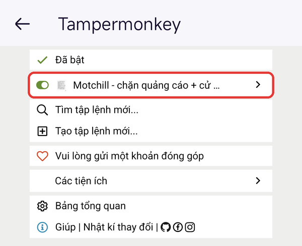

# Motchill không quảng cáo

Xem phim trên **motchilltu.com** không còn banner, popup hay tab quảng cáo tự bật. Trình phát có thêm tua 10 giây, giữ để xem nhanh x2 và khóa màn hình khi xem toàn màn hình.

| Tính năng | Cách dùng |
| --- | --- |
| Chặn quảng cáo | Tự động, không cần bấm gì |
| Tua 10 giây | Chạm 2 lần vào nửa trái (lùi) hoặc nửa phải (tới) của khung phim |
| Xem nhanh x2 | Giữ ngón tay trên phim, thả ra là về tốc độ cũ |
| Khóa màn hình | Bấm ổ khóa ở mép phải khi đang xem toàn màn hình |

Dùng được trên **Android (Firefox)** và **iPhone, iPad (Safari)**. Chrome trên điện thoại không cài được tiện ích nên không dùng được.

**Link cài đặt:**

```
https://raw.githubusercontent.com/nhattruong16062003/motchill-noads/main/motchill-noads.user.js
```

---

## Cài trên Android (Firefox)

Mỗi máy chỉ cài một lần, sau đó tự chạy và tự cập nhật.

**Bước 1.** Cài **Firefox** từ CH Play.

**Bước 2.** Cài tiện ích **Tampermonkey** cho Firefox:

1. Mở Firefox, bấm **⋮** (góc phải trên) → **Tiện ích** → **Quản lý tiện ích**.
2. Tìm **Tampermonkey**, bấm **+**, rồi bấm **Thêm** để đồng ý.

Cài xong, trong menu **⋮** sẽ có dòng **Tiện ích · Tampermonkey**:


**Bước 3.** Mở **link cài đặt** ở trên bằng Firefox (bấm vào link, hoặc chép rồi dán vào thanh địa chỉ). Tampermonkey hiện trang cài đặt. Kiểm tra tên là *Motchill - chặn quảng cáo + cử chỉ tua*, nguồn là link GitHub, rồi kéo xuống cuối trang và bấm **Cài đặt**.


> Nếu máy đã có bản cũ, nút sẽ là **Cập nhật**. Nếu trước đó bạn đã xóa script, nút sẽ là **Cài lại**. Bấm nút đó là được.

**Bước 4.** Mở **motchilltu.com** và xem phim. Muốn kiểm tra script đang chạy: bấm **⋮** → **Tiện ích** → **Tampermonkey**, thấy dòng *Motchill* có công tắc màu xanh là được.



---

## Cài trên iPhone, iPad (Safari)

Cần iOS 15.1 trở lên. Phải dùng **Safari**; Chrome và Firefox trên iPhone không chạy được script.

> Phần iPhone chưa được thử trên máy thật. Các hình dưới đây là **hình minh họa**, chữ trên máy bạn có thể khác một chút.

**Bước 1.** Mở App Store, tìm **Userscripts** (miễn phí), bấm **Nhận**. Mở ứng dụng một lần để nó tự tạo thư mục chứa script.


**Bước 2.** Vào **Cài đặt → Ứng dụng → Safari → Phần mở rộng** (iOS 17 trở xuống: **Cài đặt → Safari → Phần mở rộng**). Bật **Userscripts** và đặt quyền là **Cho phép**, ít nhất cho motchilltu.com.


**Bước 3.** Mở **link cài đặt** ở trên bằng Safari. Bấm **AA** (hoặc biểu tượng mảnh ghép) ở thanh địa chỉ → **Userscripts**, rồi bấm nút cài đặt hiện ra.

**Bước 4.** Mở **motchilltu.com** trong Safari, bấm **AA** → **Userscripts**. Thấy script *Motchill* đang bật thì tải lại trang là xong.


**Nếu bước 3 không hiện nút cài:** tải file `motchill-noads.user.js` về máy, mở ứng dụng **Tệp**, chuyển file vào thư mục **Userscripts** (thường ở mục *Trên iPhone*), rồi làm tiếp bước 4.


---

## Cách dùng khi xem phim

Chọn server **VIP #1**. Server VIP #2 là trình phát của trang khác nên không có tua, x2 và khóa (quảng cáo vẫn bị chặn).

Trang phim không còn quảng cáo:


**Giữ ngón tay** trên phim để xem x2. Thả tay ra là về tốc độ cũ.


**Chạm 2 lần** vào nửa phải để tới 10 giây, nửa trái để lùi 10 giây. Chạm liên tiếp để tua thêm 10 giây mỗi lần.

 

**Khóa màn hình** (chỉ có khi xem toàn màn hình): chạm 1 lần vào phim để hiện thanh điều khiển, rồi bấm ổ khóa ở mép phải.


Khi đã khóa, thanh điều khiển ẩn hết: không dừng được phim, không thoát toàn màn hình được. Vẫn **tua 10 giây** và **giữ x2** như thường. Muốn mở khóa: chạm 1 lần vào phim, ổ khóa hiện lại khoảng 2,5 giây, bấm vào nó.


---

## Cập nhật

- **Android:** Tampermonkey tự kiểm tra bản mới định kỳ. Muốn cập nhật ngay, mở lại link cài đặt rồi bấm **Cập nhật**.
- **iPhone:** mở lại link cài đặt trong Safari và cài lại.

## Gặp lỗi

| Hiện tượng | Cách xử lý |
| --- | --- |
| Quảng cáo vẫn hiện | Kiểm tra đang dùng Firefox (Android) hoặc Safari (iPhone), không phải tab riêng tư. Tải lại trang. |
| Không có tua, x2, ổ khóa | Chọn server **VIP #1**. |
| Không thấy ổ khóa | Ổ khóa chỉ có khi xem toàn màn hình. Chạm 1 lần vào phim để hiện. |
| Trang đổi sang tên miền khác, script hết tác dụng | Script chỉ chạy trên motchilltu.com. Chờ bản cập nhật mới. |

## Gỡ cài đặt

- **Android:** Firefox → **⋮** → **Tiện ích** → **Tampermonkey** → **Bảng tổng quan**, bấm biểu tượng thùng rác ở dòng *Motchill*.
- **iPhone:** mở ứng dụng **Userscripts** hoặc thư mục **Userscripts** trong ứng dụng Tệp, xóa file `motchill-noads.user.js`.
