# Motchill userscripts

Ba script nhỏ giúp xem phim trên **Motchill** (hiện là motchillsa.com) dễ chịu hơn: không quảng cáo, tua và xem nhanh bằng cử chỉ, nhớ chỗ đang xem dở. Script chạy ngay trong trình duyệt, không cần cài ứng dụng riêng.

Mỗi script chạy riêng. Bạn cần cái nào thì cài cái đó.

| Script | Làm gì | Android | iPhone, iPad | Máy tính (Chrome) | Hướng dẫn dùng |
| --- | --- | :---: | :---: | :---: | --- |
| Chặn quảng cáo + tối ưu mạng | Bỏ banner, popup, tab quảng cáo tự mở, quảng cáo video trước phim; đỡ tốn 4G | Có | Có | Có | [Xem](noads/README.md) |
| Thao tác trình phát | Chạm 2 lần để tua 10 giây, giữ để xem x2, khóa màn hình | Có | Không | Có | [Xem](gestures/README.md) |
| Lịch sử xem | Nhớ chỗ đang xem dở, mở lại là xem tiếp | Có | Chưa nên cài | Có | [Xem](history/README.md) |

Trên iPhone, iPad chỉ nên cài **Chặn quảng cáo**. Lý do có trong hướng dẫn của từng script.

Motchill có 2 bản trang khác nhau, đều hay đổi tên miền. Script chạy trên mọi tên miền có chữ *motchill*:

- **Bản motchillsa.com** (trước là motchilltu.com): cả 3 script đều dùng được.
- **Bản motchilln.fm** (trước là motchillt.app): chỉ **Chặn quảng cáo** có tác dụng. Trình phát của bản này đã có sẵn nút tua 10 giây, khóa màn hình, giữ để tua nhanh và hỏi xem tiếp chỗ cũ.

**Link cài đặt** (Android mở bằng Firefox, iPhone mở bằng Safari, máy tính mở bằng Chrome):

- Chặn quảng cáo: https://raw.githubusercontent.com/nhattruong16062003/motchill-userscripts/main/noads/motchill-noads.user.js
- Thao tác trình phát: https://raw.githubusercontent.com/nhattruong16062003/motchill-userscripts/main/gestures/motchill-gestures.user.js
- Lịch sử xem: https://raw.githubusercontent.com/nhattruong16062003/motchill-userscripts/main/history/motchill-history.user.js

---

## Cài trên Android (Firefox)

Chrome trên điện thoại không cài được tiện ích, nên phải dùng Firefox. Mỗi máy chỉ cần cài một lần, sau đó script tự chạy và tự cập nhật.

**Bước 1.** Cài **Firefox** từ CH Play.

**Bước 2.** Cài tiện ích **Tampermonkey** cho Firefox:

1. Mở Firefox, bấm **⋮** (góc phải trên) → **Tiện ích** → **Quản lý tiện ích**.
2. Tìm **Tampermonkey**, bấm **+**, rồi bấm **Thêm**.

Cài xong, trong menu **⋮** sẽ có dòng **Tiện ích · Tampermonkey**:

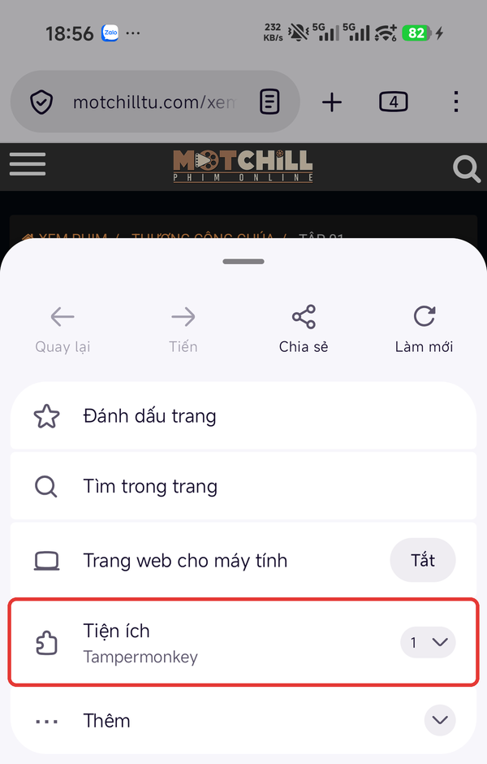

**Bước 3.** Mở link cài đặt của script bạn muốn bằng Firefox (bấm vào link, hoặc chép rồi dán vào thanh địa chỉ). Tampermonkey hiện trang cài đặt. Kiểm tra tên script, **TÁC GIẢ** là *zic*, **NGUỒN** là link GitHub ở trên. Kéo xuống cuối trang, bấm **Cài đặt**.

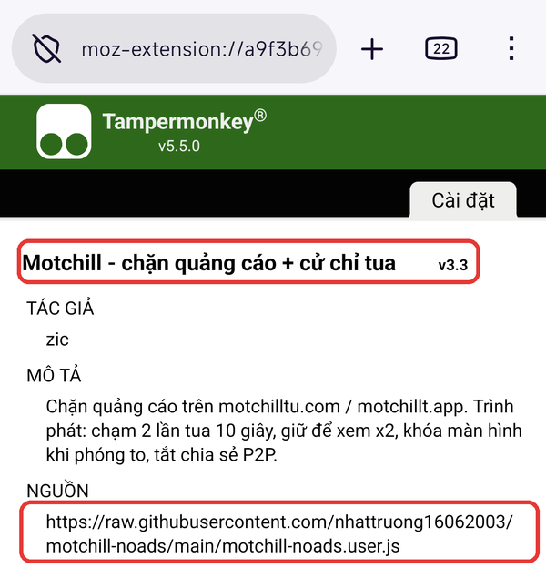

> Nếu script đã có trên máy, nút sẽ là **Cập nhật** (khi có bản mới hơn) hoặc **Cài lại** (khi cùng phiên bản).

Muốn cài thêm script khác, làm lại bước 3 với link của script đó.

> Máy từng cài bản cũ *Motchill - chặn quảng cáo + cử chỉ tua* (một script gộp chung): gỡ bản đó đi (xem phần **Gỡ cài đặt** ở cuối trang). Các script mới đã thay cho nó.

**Bước 4.** Mở **motchillsa.com** và xem phim. Muốn kiểm tra: bấm **⋮** → **Tiện ích** → **Tampermonkey**. Các script đã cài hiện ra, công tắc màu xanh là đang chạy.

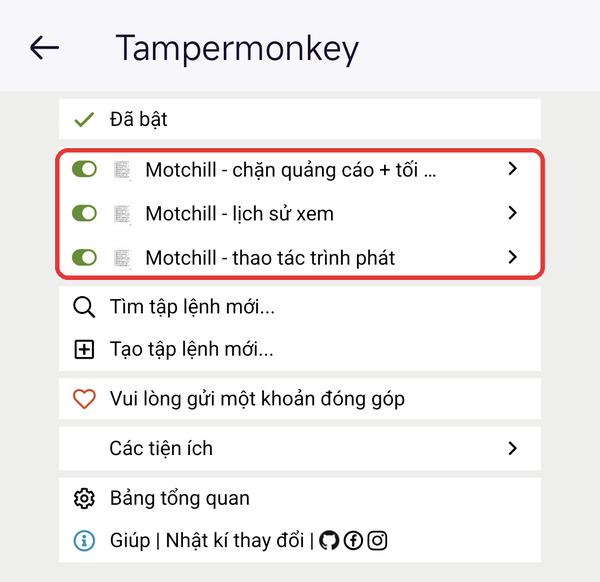

**Nếu cài Lịch sử xem:** cho phép trang tự phát phim, để phim tự chạy tiếp từ chỗ cũ. Trên motchillsa.com, chạm biểu tượng **tấm khiên** bên trái thanh địa chỉ → **Quyền hạn** → **Tự động phát** → **Cho phép âm thanh và video**. Có hình trong [hướng dẫn Lịch sử xem](history/README.md).

---

## Cài trên iPhone, iPad (Safari)

Cần iOS 15.1 trở lên. Phải dùng **Safari**; Chrome và Firefox trên iPhone không chạy được script. Trên iPhone chỉ cài script **Chặn quảng cáo**.

> Phần iPhone chưa được thử trên máy thật. Các hình dưới đây là **hình minh họa**, chữ trên máy bạn có thể khác một chút.

**Bước 1.** Mở App Store, tìm **Userscripts** (miễn phí), bấm **Nhận**. Mở ứng dụng một lần.

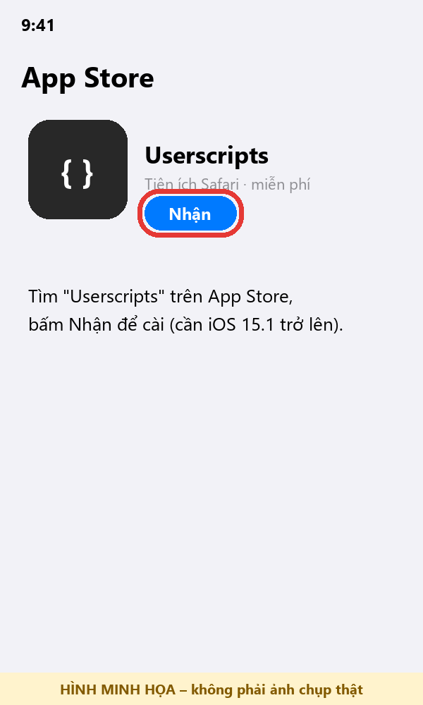

**Bước 2.** Vào **Cài đặt → Ứng dụng → Safari → Phần mở rộng** (iOS 17 trở xuống: **Cài đặt → Safari → Phần mở rộng**). Bật **Userscripts** và cho phép nó chạy, ít nhất là trên motchillsa.com. Trang đổi sang tên miền mới thì cho phép thêm tên miền đó (hoặc chọn cho phép trên mọi trang web).

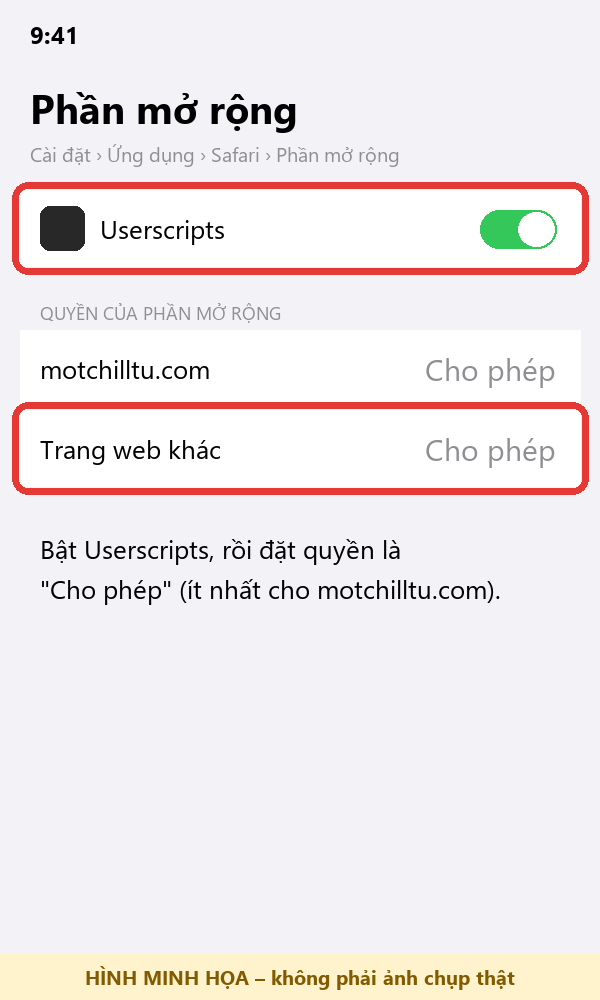

**Bước 3.** Mở link cài đặt **Chặn quảng cáo** ở trên bằng Safari. Bấm **AA** (hoặc biểu tượng mảnh ghép) ở thanh địa chỉ → **Userscripts**, rồi bấm nút cài đặt hiện ra.

**Bước 4.** Mở **motchillsa.com** trong Safari, bấm **AA** → **Userscripts**. Thấy script đang bật thì tải lại trang là xong.

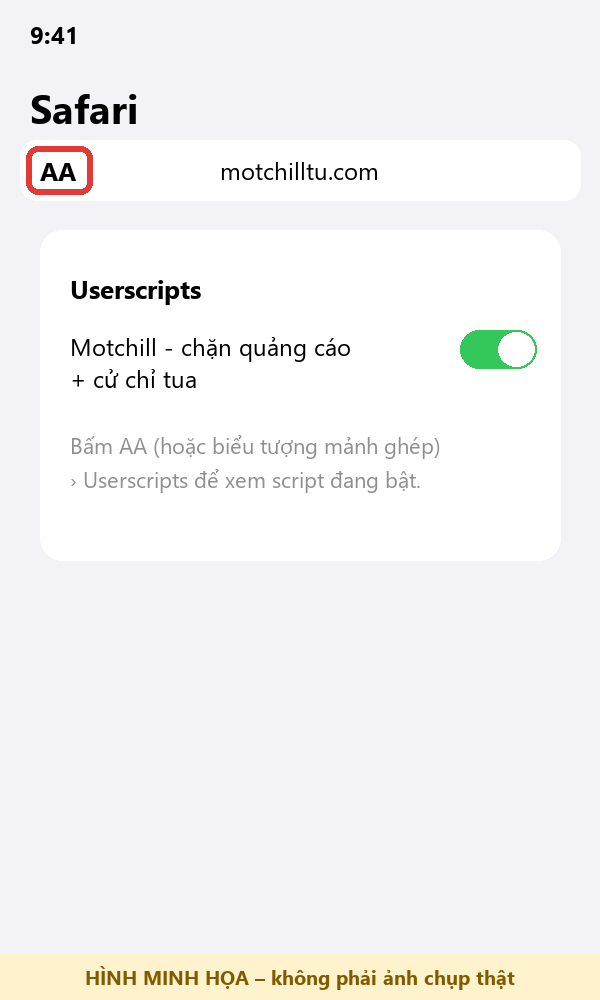

**Nếu bước 3 không hiện nút cài:** tải file `motchill-noads.user.js` về máy. Mở ứng dụng **Tệp**, chuyển file vào thư mục **Userscripts** (thường nằm trong mục *Trên iPhone*), rồi làm tiếp bước 4.

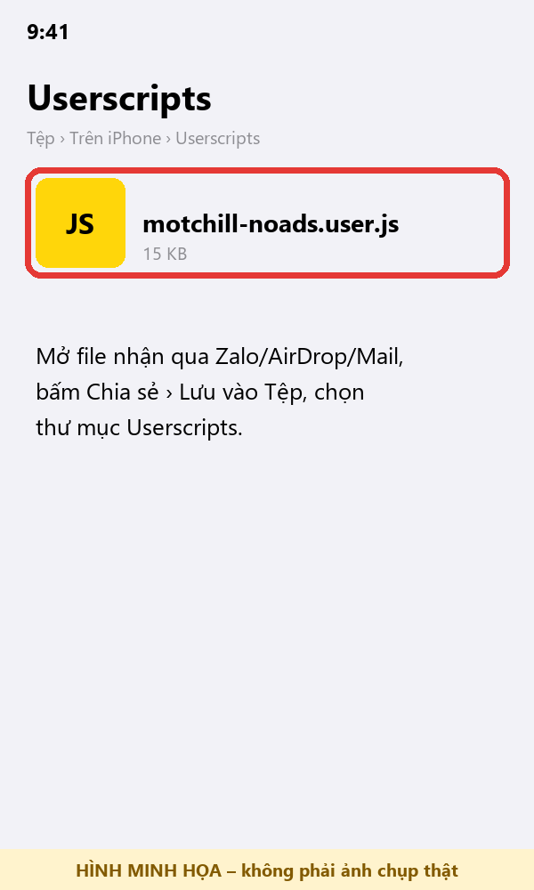

---

## Cài trên máy tính (Chrome)

Mỗi máy chỉ cần cài một lần, sau đó script tự chạy và tự cập nhật.

**Bước 1.** Cài **Tampermonkey** từ [Chrome Web Store](https://chromewebstore.google.com/detail/tampermonkey/dhdgffkkebhmkfjojejmpbldmpobfkfo), bấm **Thêm vào Chrome**.

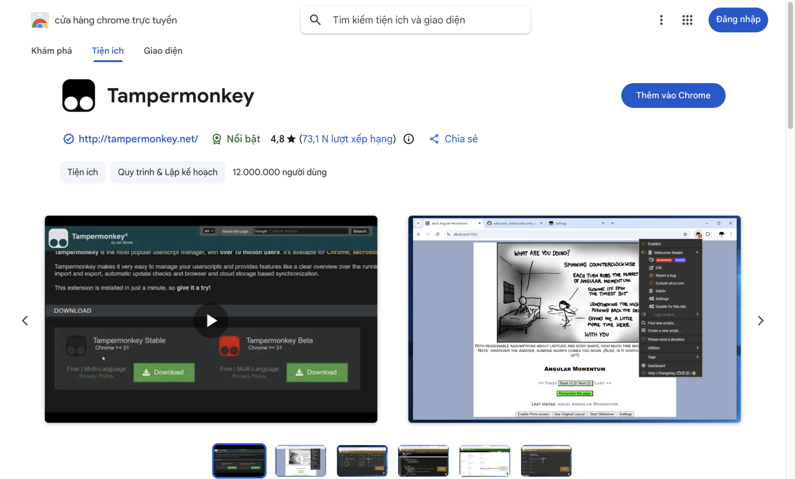

**Bước 2.** Mở `chrome://extensions` → **Tampermonkey** → **Chi tiết**, bật **Cho phép tập lệnh của người dùng** (*Allow User Scripts*, Chrome 138 trở lên). Với Chrome cũ hơn, bật **Chế độ dành cho nhà phát triển** ở góc phải trên trang `chrome://extensions`. Không bật thì script không chạy.

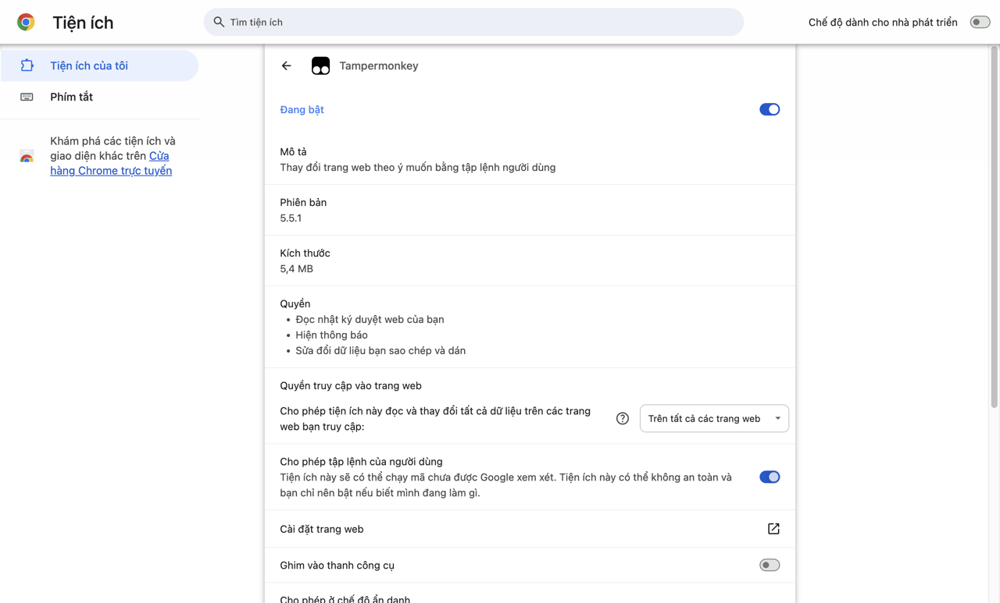

**Bước 3.** Mở từng link cài đặt ở trên bằng Chrome. Trang Tampermonkey hiện ra, bấm **Cài đặt**. Muốn cài thêm script khác, làm lại bước này với link của script đó.

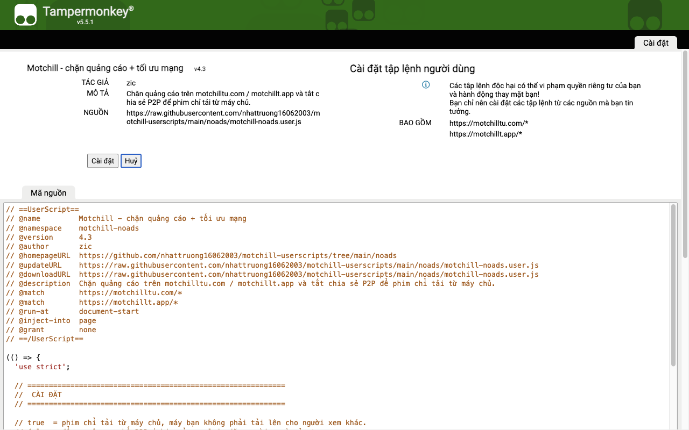

**Bước 4.** Mở **motchillsa.com** và xem phim. Muốn kiểm tra: mở **Tampermonkey** → **Bảng tổng quan**; các script đã cài phải đang bật.

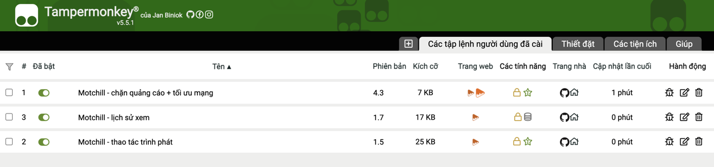

Trên máy tính dùng chuột: **nháy đúp** bên trái hoặc bên phải khung phim để tua 10 giây, **giữ chuột** để xem nhanh x2.

---

## Cập nhật

**Android:** Tampermonkey tự kiểm tra bản mới định kỳ và tự cập nhật, bạn không cần làm gì.

Muốn cập nhật ngay: mở lại link cài đặt của script. Trang hiện số phiên bản mới cạnh tên script, còn dòng **PHIÊN BẢN CÀI ĐẶT** là bản đang có trên máy. Bấm **Cập nhật**.

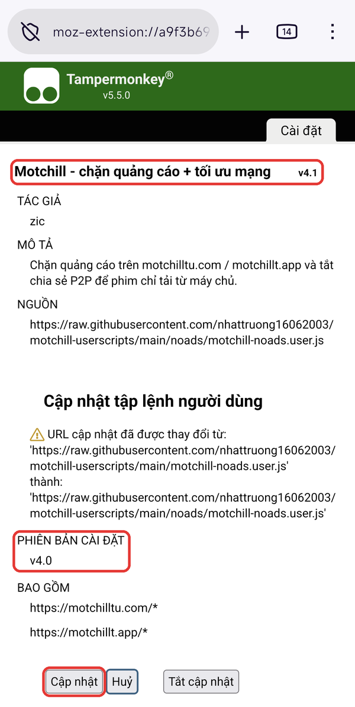

- Nếu trang hiện cảnh báo **"Ít nhất một câu lệnh @include, @match hoặc @exclude được thay đổi"** (ví dụ khi trang đổi tên miền): Tampermonkey sẽ **không tự cập nhật** bản này, phải mở lại link cài và bấm **Cập nhật** cho từng script. Cập nhật xong thì tải lại trang phim.

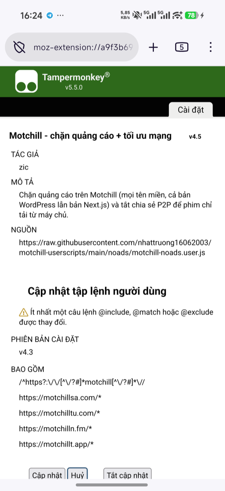

- Vừa có bản mới mà trang vẫn hiện bản cũ: chờ vài phút rồi mở lại. Hoặc thêm `?v=` và một số bất kỳ vào cuối link, ví dụ `.../motchill-noads.user.js?v=2`.
- Xem bản đang cài: **⋮** → **Tiện ích** → **Tampermonkey** → **Bảng tổng quan**, bấm biểu tượng cây bút ở dòng của script. Tên tab vừa mở có số phiên bản ở cuối.

**iPhone:** mở lại link cài đặt trong Safari và cài lại.

**Máy tính (Chrome):** Tampermonkey tự cập nhật giống Android. Muốn cập nhật ngay: mở lại link cài đặt và bấm **Cập nhật**. Xem bản đang cài ở cột **Phiên bản** trong **Bảng tổng quan**.

## Gỡ cài đặt

- **Android:** Firefox → **⋮** → **Tiện ích** → **Tampermonkey** → **Bảng tổng quan**, bấm biểu tượng thùng rác ở dòng của script muốn gỡ.
- **Máy tính (Chrome):** bấm biểu tượng Tampermonkey trên thanh công cụ → **Bảng tổng quan**, bấm biểu tượng thùng rác ở dòng của script muốn gỡ.
- **iPhone:** mở ứng dụng **Userscripts** hoặc thư mục **Userscripts** trong ứng dụng **Tệp**, xóa file `motchill-noads.user.js`.

Lưu ý: gỡ script **Lịch sử xem** thì danh sách phim đang xem dở cũng mất theo.
