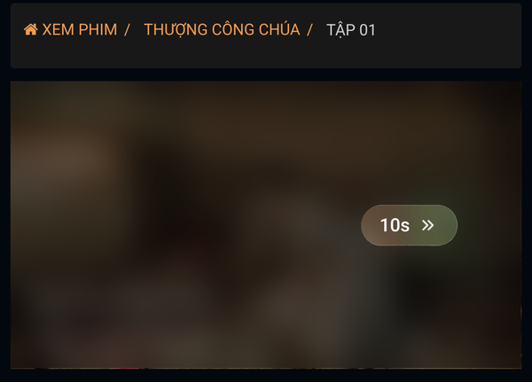
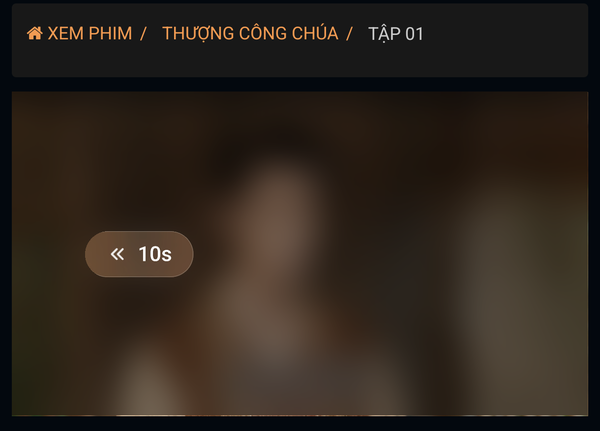
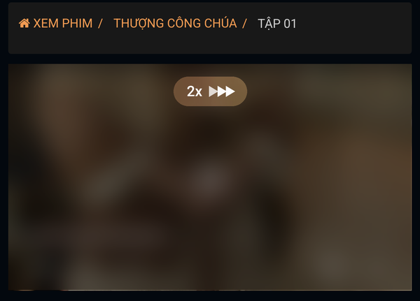
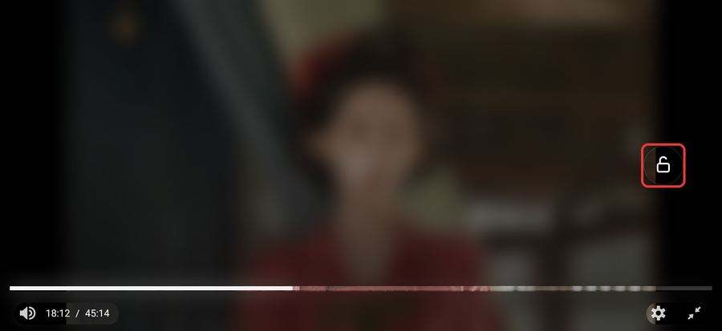

# Thao tác trình phát

Tên khi cài: *Motchill - thao tác trình phát* (phiên bản 1.3).

Thêm cử chỉ cho trình phát phim trên **motchilltu.com**: chạm 2 lần để tua 10 giây, giữ ngón tay để xem nhanh x2, khóa màn hình khi xem toàn màn hình để lỡ chạm cũng không dừng phim.

## Dùng được trên

| Android (Firefox) | iPhone, iPad |
| :---: | :---: |
| Có | Không |

Trên iPhone, khi xem toàn màn hình, máy chuyển sang trình phát riêng của Apple, nên các cử chỉ này không hoạt động. Vì vậy không cần cài script này trên iPhone.

Chỉ chạy trên server **VIP #1**. Server VIP #2 là trình phát của trang khác nên không có các cử chỉ này.

## Cài đặt

Link cài đặt:

```
https://raw.githubusercontent.com/nhattruong16062003/motchill-userscripts/main/gestures/motchill-gestures.user.js
```

Các bước cài từng bước trên Android có trong [hướng dẫn chung](../README.md).

## Cách dùng

### Tua 10 giây

**Chạm 2 lần** vào nửa phải khung phim để tới 10 giây, vào nửa trái để lùi 10 giây. Chạm tiếp để tua thêm 10 giây mỗi lần. Khi tua, một nhãn nhỏ nền mờ hiện **10s »** hoặc **« 10s**.

 

### Xem nhanh x2

**Giữ ngón tay** trên phim: phim chạy nhanh gấp đôi. Thả tay ra là về tốc độ thường. Phía trên khung phim hiện nhãn **2x** với ba mũi tên sáng lần lượt.



### Khóa màn hình

Chỉ có khi xem toàn màn hình.

1. Chạm 1 lần vào phim để hiện thanh điều khiển. Ổ khóa tròn hiện cùng lúc ở mép trái màn hình.
2. Bấm vào ổ khóa để khóa.



Khi đã khóa:

- Thanh điều khiển ẩn hết. Không dừng phim và không thoát toàn màn hình được, nên lỡ chạm cũng không sao.
- Vẫn tua 10 giây và giữ để xem x2 như thường.
- Chạm 1 lần vào phim để hiện ổ khóa, chạm lần nữa để ẩn. Ổ khóa tự ẩn sau khoảng 2,5 giây.
- Muốn mở khóa: bấm vào ổ khóa khi nó đang hiện.
- Bấm nút Quay lại của điện thoại để thoát toàn màn hình cũng sẽ mở khóa.


## Lưu ý

- Không tua được, không xem x2 được: kiểm tra bạn đang chọn server **VIP #1**.
- Không thấy ổ khóa: ổ khóa chỉ có khi xem toàn màn hình. Chạm 1 lần vào phim để hiện.
- Script chỉ chạy trên motchilltu.com. Nếu trang đổi sang tên miền khác, cần chờ bản cập nhật.
