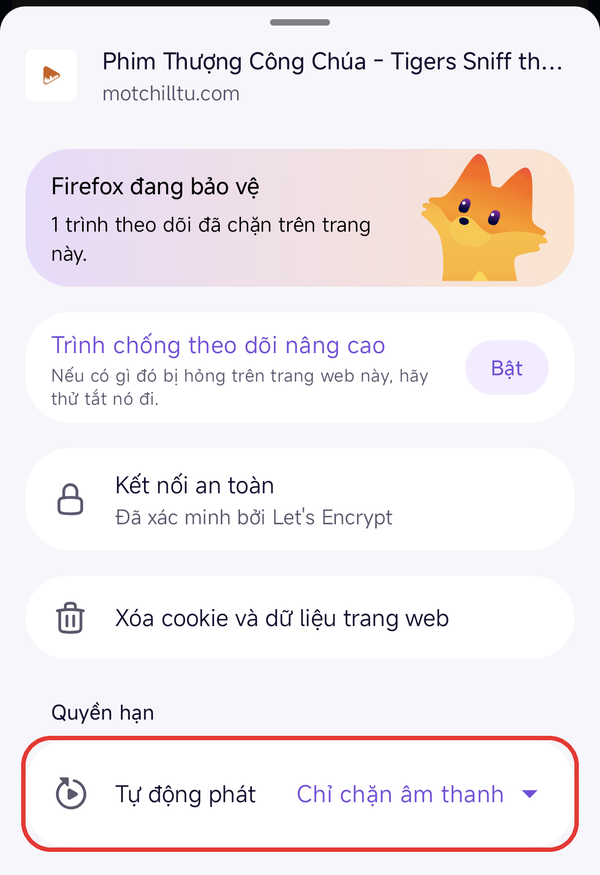
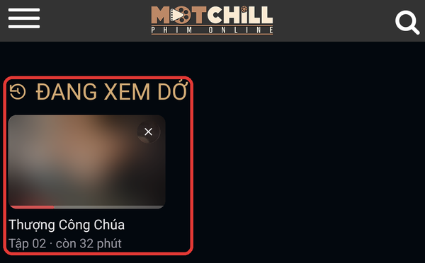

# Lịch sử xem

Tên khi cài: *Motchill - lịch sử xem* (phiên bản 1.6).

Nhớ chỗ bạn đang xem dở ở từng phim trên **motchilltu.com**. Mở lại tập đó là phim tự tua tới chỗ cũ và chạy tiếp. Trang chủ có thêm hàng **Đang xem dở** để vào lại phim nhanh.

Script này không bắt buộc. Cài thêm nếu bạn cần.

## Dùng được trên

| Android (Firefox) | iPhone, iPad |
| :---: | :---: |
| Có | Chưa nên cài |

Script chưa được thử trên iPhone, nên hiện tại trên iPhone chỉ nên cài script chặn quảng cáo.

Chỉ chạy trên server **VIP #1**.

## Cài đặt

Link cài đặt:

```
https://raw.githubusercontent.com/nhattruong16062003/motchill-userscripts/main/history/motchill-history.user.js
```

Các bước cài từng bước trên Android có trong [hướng dẫn chung](../README.md).

### Cho phép tự động phát (làm một lần)

Firefox mặc định không cho trang tự phát phim. Muốn phim tự chạy tiếp khi mở lại:

1. Mở một trang bất kỳ của **motchilltu.com** bằng Firefox.
2. Chạm biểu tượng **tấm khiên** ở bên trái thanh địa chỉ.
3. Ở mục **Quyền hạn**, chạm **Tự động phát**, chọn **Cho phép âm thanh và video** (mặc định là *Chỉ chặn âm thanh*).



Nếu không cho phép, phim vẫn tua tới chỗ cũ nhưng đứng yên. Bấm Play một lần là phim chạy tiếp từ chỗ đã lưu.

## Cách dùng

### Xem tiếp chỗ cũ

Bạn không cần bấm gì. Script tự ghi lại chỗ đang xem khoảng 5 giây một lần, và mỗi khi bạn dừng phim, chuyển sang ứng dụng khác, khóa máy hoặc rời trang. Nếu trang bị tải lại bất ngờ, bạn chỉ lỡ nhiều nhất khoảng 5 giây.

Mở lại tập đang xem dở (từ hàng **Đang xem dở** hoặc từ danh sách tập): phim tự nhảy tới chỗ cũ và tự chạy.

Thấy nút **Chạm để bật tiếng** ở góc dưới bên phải khung phim nghĩa là phim đang chạy không có tiếng. Chạm vào phim để bật tiếng.

### Hàng "Đang xem dở" ở trang chủ

Đầu trang chủ có hàng **Đang xem dở**. Mỗi thẻ gồm ảnh phim, thanh đỏ cho biết đã xem tới đâu, tên phim và một dòng như *Tập 02 · còn 32 phút*.

- Chạm vào thẻ để mở đúng tập đang xem.
- Bấm **×** ở góc ảnh để xóa phim khỏi hàng.



Xem quá 95% một tập thì tập đó tính là đã xem xong: thẻ chuyển sang tập kế tiếp và ghi *chưa xem*. Xem xong tập cuối thì phim tự rời khỏi hàng.

Hàng này giữ 20 phim bạn xem gần nhất.

Ở trang khác: bấm **menu ba gạch** → **LỊCH SỬ XEM** (ngay dưới *TV SHOWS*) để về trang chủ, đúng chỗ hàng **Đang xem dở**.

## Lưu ý

- Lịch sử được lưu trong Tampermonkey, không lưu trong trang web. Vì vậy xóa dữ liệu của trang web thì lịch sử vẫn còn. Trang đổi tên miền và script được cập nhật theo thì lịch sử cũ cũng vẫn còn.
- Lịch sử chỉ mất khi bạn gỡ script này hoặc gỡ Tampermonkey.
- Trang motchilltu.com cũng có sẵn chức năng nhớ chỗ xem (`OPCMS-PlayerPosition`), nhưng dùng chung cho mọi phim nên dễ tua nhầm. Script tắt chức năng đó để hai bên không tua đè lên nhau.
- Mở lại mà phim chạy từ đầu: tập đó mới xem chưa tới 10 giây, hoặc bạn đang không chọn server **VIP #1**.
- Phim tới đúng chỗ cũ nhưng không tự chạy: xem lại phần **Cho phép tự động phát** ở trên, hoặc bấm Play một lần.
