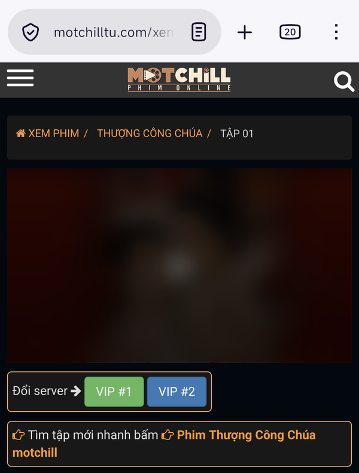

# Chặn quảng cáo + tối ưu mạng

Tên khi cài: *Motchill - chặn quảng cáo + tối ưu mạng* (phiên bản 4.5).

Xem phim trên **Motchill** không còn quảng cáo, cả bản trang **motchillsa.com** (trước là motchilltu.com) lẫn **motchilln.fm** (trước là motchillt.app). Script tự chạy, bạn không cần bấm gì.

## Dùng được trên

| Android (Firefox) | iPhone, iPad (Safari) | Máy tính (Chrome) |
| :---: | :---: | :---: |
| Có | Có | Có |

Đây là script duy nhất nên cài trên iPhone, iPad.

## Cài đặt

Link cài đặt:

```
https://raw.githubusercontent.com/nhattruong16062003/motchill-userscripts/main/noads/motchill-noads.user.js
```

Các bước cài trên Android, iPhone và máy tính có trong [hướng dẫn chung](../README.md).

## Script làm gì

- Ẩn banner quảng cáo ở trên và dưới trang.
- Ẩn banner nằm ngay dưới khung phim.
- Chặn popup quảng cáo hiện giữa màn hình.
- Chặn tab quảng cáo tự mở ra khi bạn chạm vào bất kỳ chỗ nào trên trang.
- Bỏ quảng cáo video trước tập phim trong trình phát.
- Ẩn nút chia sẻ trên trình phát.
- Tắt chia sẻ dữ liệu giữa người xem (P2P). Phim chỉ tải từ máy chủ, máy bạn không phải tải lên cho người khác, nên đỡ tốn 4G và pin.

Trang xem phim sau khi cài:



## Lưu ý

- Một số phim có dòng quảng cáo nằm sẵn trong hình, ví dụ "Bộ phim này do ... tài trợ". Dòng đó là một phần của video nên không xóa được.
- Quảng cáo vẫn hiện: kiểm tra bạn đang mở bằng Firefox (Android) hoặc Safari (iPhone), không phải tab riêng tư, rồi tải lại trang.
- Script chạy trên mọi tên miền có chữ *motchill*, nên trang đổi tên miền vẫn có tác dụng.
- Muốn để trang phát quảng cáo video như bình thường (vẫn chặn banner, popup): mở **Tampermonkey** → **Bảng tổng quan**, bấm biểu tượng cây bút ở dòng của script, đổi `BLOCK_VIDEO_ADS = true` thành `false` rồi lưu. Lần script tự cập nhật sau có thể ghi đè thay đổi này, khi đó sửa lại.
